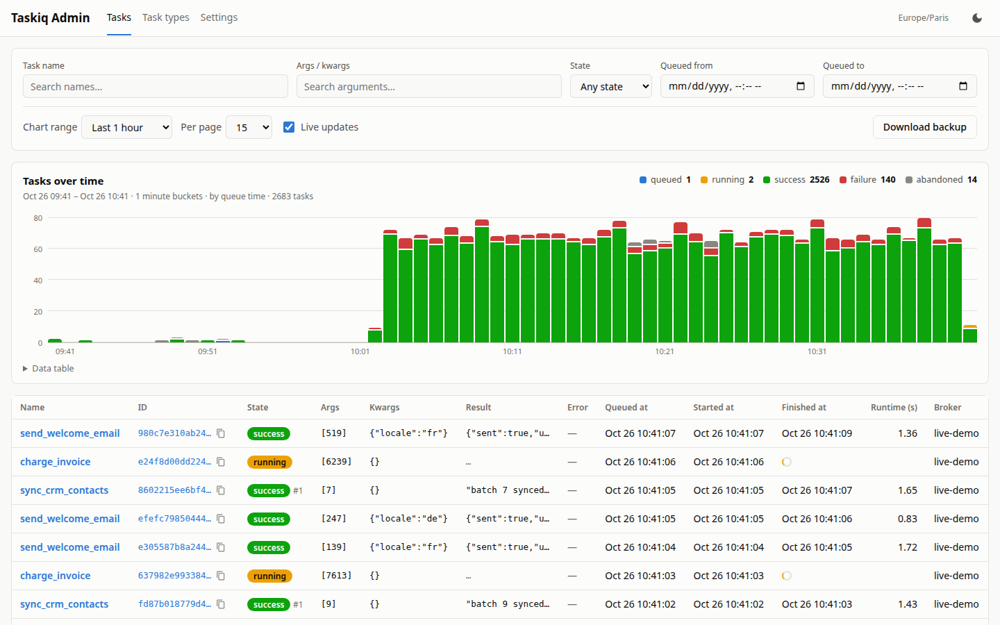
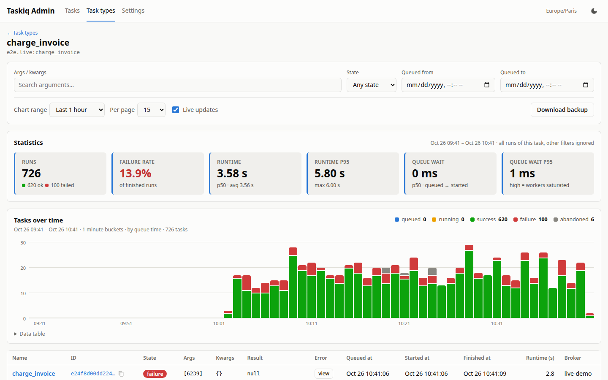
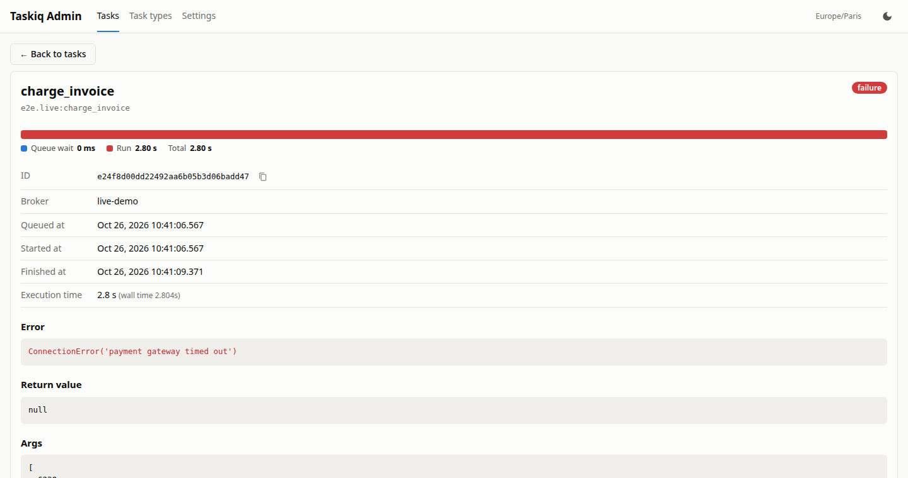

# taskiq-go-admin

[](https://github.com/louis-t/taskiq-go-admin/actions/workflows/ci.yml)
[](LICENSE)
[](https://github.com/louis-t/taskiq-go-admin/pkgs/container/taskiq-go-admin)

taskiq-go-admin is an admin panel for [taskiq](https://github.com/taskiq-python/taskiq) task queues. It works with any broker.
It is a Go and htmx rewrite of [taskiq-admin](https://github.com/taskiq-python/taskiq-admin), and it is fed by the same
middleware, unchanged.
It ships as one Go binary with SQLite built in: no cgo, no Node, nothing else to run.



## Features

- **Tasks**: the list filters by state, a part of the task name, args or kwargs, and a queue-date range. Pages are
  browsed with cursors and refresh live.
- **Chart**: tasks over time, stacked by state. Click a bar to narrow the list to that time, or click a state in the
  legend to filter on it.
- **Task types**: each task name gets its run count, failure rate, runtime p50/p95, queue wait, chart and list.
- **Task details**: a queued → started → finished timeline, then args, kwargs, labels, return value, error and retry
  number.
- **Stuck tasks** (opt-in): tasks running or queued for too long are flagged `stale`.
- **Retention**: an optional TTL deletes old tasks in small batches, so incoming reports are never blocked.
- **Backup**: download a consistent SQLite snapshot while the app keeps running.

| | |
|---|---|
|  |  |

## Quick start

```python
from taskiq.middlewares.taskiq_admin_middleware import TaskiqAdminMiddleware

broker = broker.with_middlewares(
    TaskiqAdminMiddleware(
        url="http://localhost:3000",
        api_token="supersecret",
        taskiq_broker_name="mybroker",
    )
)
```

```sh
docker run -d --name taskiq-admin -p 3000:3000 \
  -e TASKIQ_ADMIN_API_TOKEN=supersecret \
  -v taskiq-admin-data:/usr/database \
  ghcr.io/louis-t/taskiq-go-admin:latest
```

Open http://localhost:3000.

## Before you deploy it

- **There is no login.** Keep the panel on a private network or behind an authenticating reverse proxy. Only the
  ingestion endpoints check `TASKIQ_ADMIN_API_TOKEN`.
- Cross-site requests that change state are rejected (`Sec-Fetch-Site`/`Origin` checks), so a page in another tab
  cannot change your settings. The middleware and curl send neither header and are not affected.

## Running notes

| Variable | Default | |
|---|---|---|
| `TASKIQ_ADMIN_API_TOKEN` | *(required)* | sent by the middleware in its `access-token` header |
| `TASKIQ_ADMIN_DB_FILE_PATH` | `database/database.db` | SQLite file (`/usr/database/database.db` in the image) |
| `HOST` / `PORT` | `0.0.0.0` / `3000` | listen address. Set `PORT` (env) so the built-in healthcheck follows it |
| `TASKIQ_ADMIN_PURGE_INTERVAL` | `1m` | how often the TTL cleanup runs |
| `TASKIQ_ADMIN_PURGE_BATCH_SIZE` / `_PAUSE` | `1000` / `50ms` | rows per cleanup transaction, pause between batches |
| `TASKIQ_ADMIN_INGEST_MAX_BATCH` | `500` | most events committed in one transaction |
| `TASKIQ_ADMIN_MAX_BODY_BYTES` | `67108864` | largest middleware report accepted (64 MiB); a bigger one loses that lifecycle step |
| `TASKIQ_ADMIN_MAX_VALUE_BYTES` | `65536` | args, kwargs or return value stored whole up to this size (64 KiB); a bigger one is stored as `{"truncated":true,"bytes":N,"preview":"…"}` |
| `TASKIQ_ADMIN_LOG_LEVEL` | `info` | `debug` also logs each request |

The retention TTL and the stuck-task thresholds are runtime settings, edited in the Settings page or with
`PUT /api/settings`. They are all off by default.

- **Set a retention TTL.** SQLite copes with millions of tasks. On 5M tasks (a 2.9 GB file), the list, the
  details and the 24h views answered in 0.4–330 ms, and ingestion held 3.5k events/s. Charts and stats over 7 to
  30 days have to count every task in the range: 1–10 s at that size. Slow results are reused for up to 30 s, so
  live updates don't pile up, but the first load stays slow. Keeping days rather than months keeps every page fast.
- **Volume**: the image runs as UID 65532. Named volumes just work. A bind-mounted directory must be writable by that
  UID.
- **Restarts**: tasks that were running when the panel restarted become `abandoned`. If their result arrives later,
  it still replaces that state.
- **Images**: `:latest` and `:X.Y.Z` for releases, `:main` for the main branch, on amd64 and arm64. The version shows
  in the page footer and in `/healthz`.

### Robustness

The middleware sends its reports fire-and-forget, so they can arrive late, out of order or twice. These points come
from upstream issues:

- **Out-of-order reports** ([#16](https://github.com/taskiq-python/taskiq-admin/issues/16)): the result is the same
  whatever order the reports arrive in. Within one attempt the state only moves forward, a result beats `running`,
  and a late report only fills in missing data.
- **Retries** are recognised from the `_retries` label.
- **"Server disconnected" errors** (also #16): the idle timeout (120s) is longer than aiohttp's keep-alive, which
  caused them upstream.
- **Middleware latency** ([#8](https://github.com/taskiq-python/taskiq-admin/issues/8)): reports are written by group
  commit. That is roughly 9.6k events/s on a laptop, and a `200` is only sent once the event is committed. A
  commit survives an app crash. A power cut can lose the last commits, as with any SQLite in WAL mode with
  `synchronous=NORMAL`.
- **Date parameters** ([#14](https://github.com/taskiq-python/taskiq-admin/issues/14)): `startDate=2026-01-21` works,
  and the end date includes that whole day.

### API

- The middleware posts to `POST /api/tasks/{id}/queued|started|executed` with the `access-token` header.
- `GET /api/tasks` reads tasks with the original JSON shapes.
  - Filters: `limit`, `search`, `taskName`, `argsSearch`, `state` (including `stale`), `startDate`, `endDate`.
  - Paging: `cursorQueuedAt`, `cursorId`, `direction`.
- `GET /api/tasks/{id}` returns one task.
- `GET /api/tasks/histogram` returns chart data.
- `GET /api/tasks/backup` downloads a SQLite snapshot.
- `GET|PUT /api/settings` reads and changes the runtime settings.
- `GET /events` streams live updates (SSE).
- `GET /healthz` answers the healthcheck.

## Development

Needs Go (version in `go.mod`).

```sh
go test -race ./...    # SQLite runs in-process, no service needed
TASKIQ_ADMIN_API_TOKEN=dev make run
```

Tests cover the merge rules for every arrival order, the store (a conformance suite each database backend must
pass), ingestion, cleanup batching, the HTTP API and the pages. The middleware compatibility was also checked
end-to-end with the real Python middleware.

| Path | |
|---|---|
| `cmd/taskiq-admin` | entry point, graceful shutdown, healthcheck |
| `internal/task` | task model and the event merge rules (no I/O) |
| `internal/store`, `internal/store/sqlite` | storage contract, SQLite backend, `storetest` conformance suite |
| `internal/store/cache` | reuses slow chart/stats results for a few seconds |
| `internal/ingest` | group-commit writer |
| `internal/events` | change notifications for live updates |
| `internal/maintenance` | batched TTL cleanup, startup abandon sweep |
| `internal/web` | handlers, templates, static assets |

Only SQLite exists today. To add Postgres, MySQL or MariaDB, implement `store.Store` in `internal/store/<driver>`
and make it pass `storetest.Run`.

## Acknowledgements

This is a rewrite of [taskiq-admin](https://github.com/taskiq-python/taskiq-admin), and it relies on that project's
middleware.

## License

[MIT](LICENSE). Bundles [htmx](https://htmx.org) (0BSD).
